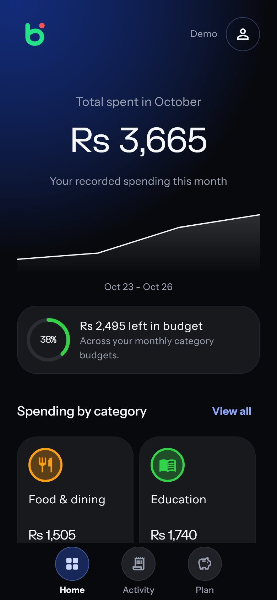
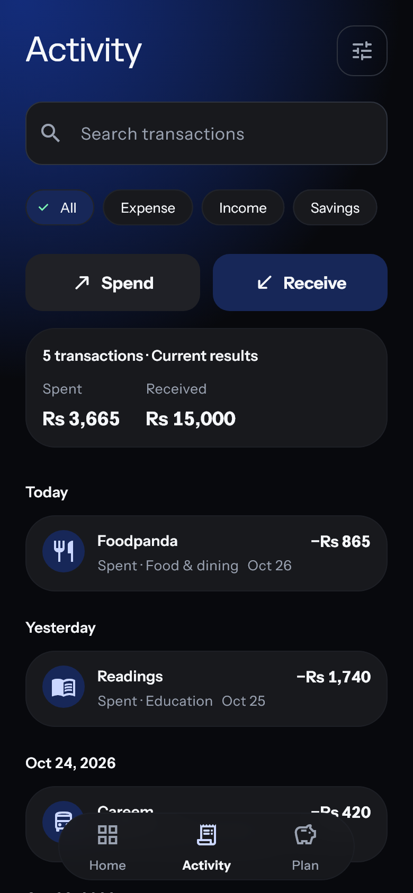
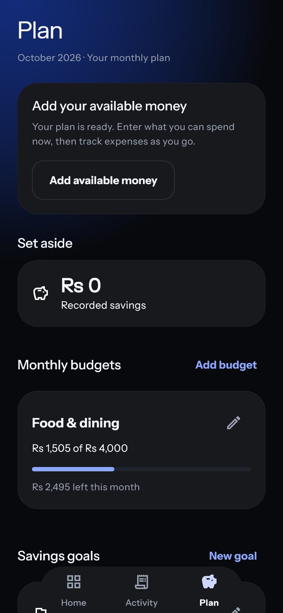
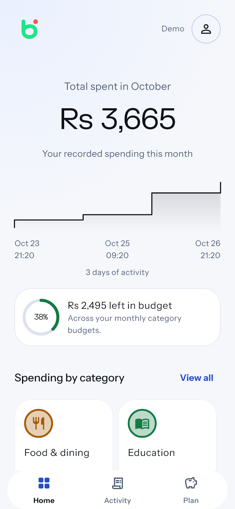

# Bachat

**Know where your money goes. Save for what matters.**

Bachat is YouthPay’s money-tracking app for teens aged 13–18. It brings everyday expenses, monthly budgets and savings goals into one place, using Pakistani rupees (PKR).

This is our **internal product showcase**. The repository and tester downloads are private and available to colleagues with repository access.

[**Try the Android app →**](https://github.com/saim-x/bachat-mobile/releases/tag/v0.1.2) · [Product brief](docs/PRODUCT-BRIEF.md) · [Developer guide](docs/DEVELOPMENT.md)

## Three screens, one everyday habit

Record what you spend, see how it fits your plan, and keep something aside for the next goal.

| Home · See the picture | Activity · Follow the details | Plan · Give money a purpose |
| :---: | :---: | :---: |
|  |  |  |
| Understand this month’s spending and what is left in your budgets. The graph starts with 24 hours and expands as current-month spending history grows. | Record money spent or received. Search, filter and review your history; edit or delete an entry when something needs correcting. | Enter available money, set monthly category limits, and track progress toward things you want to save for. |

*Screenshots use fictional demonstration records, not customer information. Tap any screenshot to see it full size. New accounts start empty.*

## How money fits together

Expense tracking is the starting point. A teen can begin with an expense straight away, or first set a budget or savings goal and enter the amount they have available to spend.

| In Bachat | What it means |
| --- | --- |
| **Available money** | The amount entered by the user, adjusted by money recorded afterward. Spending and savings set aside reduce it; received money left for spending increases it. |
| **Budget** | A monthly spending limit for a category, such as food or transport. Recording an expense uses that category’s budget. |
| **Savings goal** | A target for something that matters. Money saved separately or assigned from a receipt contributes to its progress. |

**Example: receive Rs 1,000, save Rs 400.** In Receive, choose a goal and enter Rs 400 as the amount to save. Goal progress increases by Rs 400, and the remaining Rs 600 becomes available to spend. Editing or deleting the receipt adjusts those contributions too.

Available money is manually tracked. Bachat does not connect to a bank or automatically move money into a savings account.

## Made for everyday use

- **A short route to the essentials.** Home, Activity and Plan sit in a compact floating navigation pill. The profile icon on Home opens account settings.
- **Light or dark.** Choose either appearance, or follow the phone’s setting. Layouts support different screen sizes and enlarged text.
- **Keep recording offline.** Edits stay on the device and wait to sync when a connection is available. Pending changes remain visible.
- **Personal account protection.** Email verification and a six-digit device PIN are part of the account experience.

<strong>See Home in light mode</strong>

 

The same information and navigation, with an appearance suited to lighter surroundings. This screenshot also uses demonstration records.

## Try it with the team

The current Android tester build is **0.1.2 (build 3)**.

1. Open the [private release page](https://github.com/saim-x/bachat-mobile/releases/tag/v0.1.2) while signed in to GitHub with repository access.
2. Download **bachat-0.1.2-android.apk** from Assets and open it on Android. Allow installation from the browser or file manager if the phone requests it.
3. Create a teen account, verify the email address, complete the profile and set a device PIN.
4. Try an expense, a category budget, and a received amount split between savings and spending.

For useful feedback, note what you were trying to do, what you expected, what happened, and your phone model. Use made-up amounts when sharing screenshots internally.

This is an internal Android tester release using the existing development signing configuration. iOS device testing is still pending. Parent accounts, the learning section and automatic bank, SMS or Gmail imports are outside the current release.

## Explore further

| For | Open |
| --- | --- |
| Product scope and confirmed decisions | [Product brief](docs/PRODUCT-BRIEF.md) |
| How receipts, expenses and savings interact | [Money behaviour and verification](docs/RECEIPT-SAVINGS.md) |
| Android installation and build details | [Tester release guide](docs/ANDROID-TESTER-RELEASE.md) |
| Technical setup and contributing | [Developer guide](docs/DEVELOPMENT.md) |
| Release checks and remaining launch work | [Ship-readiness notes](docs/SHIP-READINESS.md) |

Keep this repository private when sharing the app with colleagues. The release page works for testers who already have repository access.
