# Device sync, personal PIN and money flows - 2026-10-21

The updated suite has **62 passing tests**, including separate Receive categories, custom-tag search/serialization, savings classification and correction, a remote notification arriving mid-refresh, and personal PIN persistence/account isolation, salted digests, cooldowns, storage failures, PIN changes and background privacy covering an open sheet. Analyzer is clean. Android arm64 debug and web release compilation pass locally; physical Android/iOS device testing is not claimed.

Two independent Chrome instances at 1024 x 900 and 390 x 844 signed into the same disposable account with different device PINs. Actual Supabase calls verified custom spending and Receive creation, automatic savings and unchanged expense totals, reload locking, rejection of the other device's PIN, correct unlock, Lock now, reset confirmation/cancellation and changing the PIN. No successful API responses were mocked. The complete flow reported zero page errors.

A focused live run changed a transaction, budget, savings goal and profile and observed their updates on both clients within the test's 10-second window. Each client received five actual Postgres-change WebSocket events, including the later offline transaction. An offline Receive was saved locally; after reconnecting and reloading through the PIN gate it uploaded and appeared on the other client. Backend requests were aborted only during the offline segment.

Both live rollback SQL suites pass for existing authorization and new taxonomy/tag/savings constraints. The approved disposable account's sessions were revoked and the account deleted. Follow-up counts for users, profiles, transactions, budgets, goals, sessions and refresh tokens were zero. Its credentials were never saved to disk. The screenshots below were visually inspected.

| Phone dashboard | PIN lock |
|---|---|
| 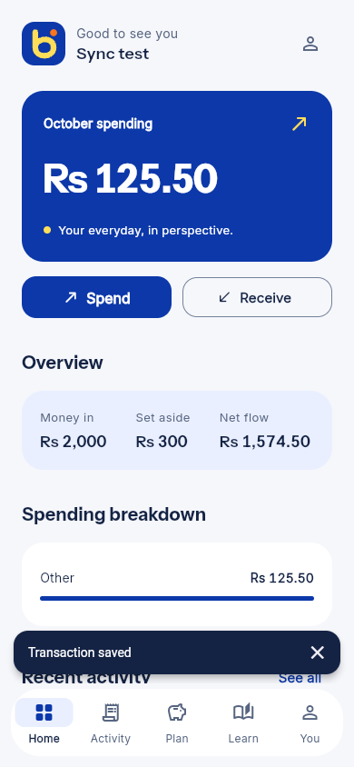 | 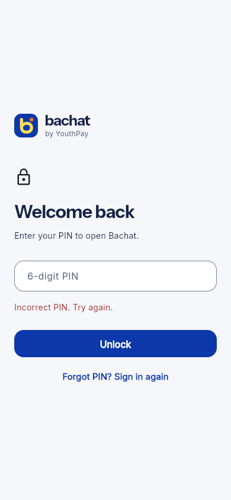 |

| Custom spending tag | Receive categories |
|---|---|
| 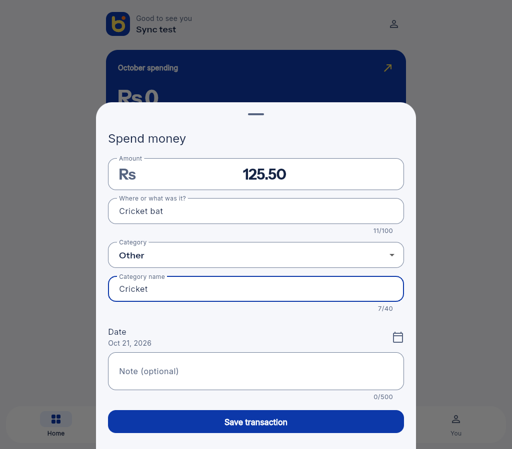 | 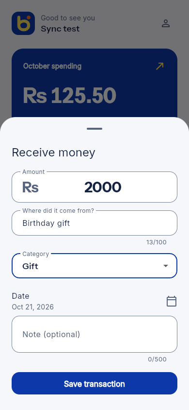 |

| Personal PIN setup | Recorded savings |
|---|---|
| 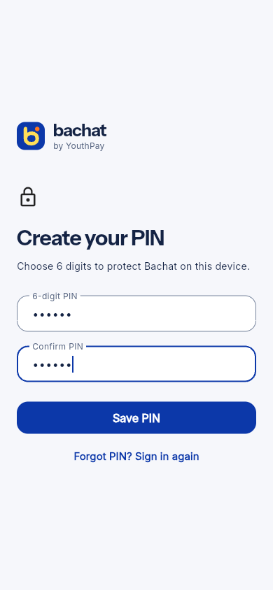 | 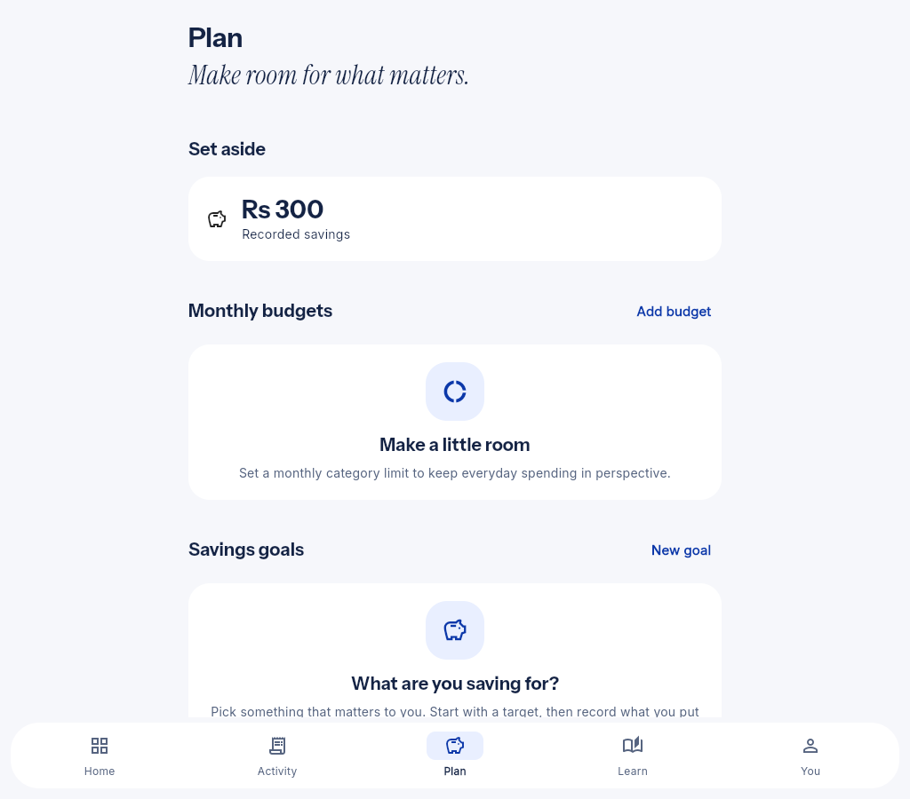 |

Existing hosted email/native-callback setup requirements remain in [BACKEND.md](BACKEND.md). PINs are local app access protection, not a replacement for platform security. Profile/money sync uses the same signed-in account; device PINs and appearance intentionally remain local. Concurrent edits to the same record retain the documented last-upload rule; savings-goal additions on separate devices are not an additive server ledger.

---

## Earlier authentication release verification

# Teen authentication verification - 2026-10-21

Analyzer is clean and **all 52 tests pass** for the final source, including the new legacy recovery regression alongside PKCE recovery. Final-source Android arm64 debug APK and web release compilation pass locally. CI also runs formatting, analysis, tests and both platform builds. iOS signing and physical-device tests have not been performed.

## Live backend and browser

Supabase migrations are applied through MCP. `supabase/tests/teen_authorization.sql` passes with rollback fixtures: verified owner CRUD, other-user isolation, unverified write rejection, parent/family blocking, immutable identity/age, category/amount/goal limits and budget uniqueness. RLS is enabled on all exposed application tables; no account-deletion RPC exists. Security advisors reported no warnings/errors, with informational notices for private deny-by-default family tables and unused indexes.

With the owner's explicit approval, two disposable users exercised real Supabase HTTP sign-in, unconfirmed-email rejection, confirmation-token exchange, teen profile creation, parent rejection, CRUD and spoofed-owner rejection for transactions/budgets/goals, recovery verification, password update, old-password rejection, refresh and logout invalidation. `scripts/check_live_auth.py` accepts fixture credentials only through hidden input or stdin; no credentials were saved to disk.

Chrome at 390 x 844 then used the actual Flutter interface and live backend for sign-in; a Rs 125.50 expense; a Rs 2,000 budget; a Rs 5,000 goal; exact savings from Rs 100 to Rs 150.25; offline transaction creation, reload and reconnection sync; sign-out and account isolation; and password recovery followed by new-password sign-in. Successful Auth/REST responses were not intercepted. Only the offline segment temporarily aborted backend requests. Zero browser page errors were reported. Screenshots below were visually inspected.

Recovery testing exposed callback loss during initial Flutter routing. The app now captures the entry URL before routing and handles it after auth listeners are installed. The successful browser recovery run loaded the real issued session into a fresh app startup.

Sessions were revoked and both temporary users deleted after testing. Queries confirmed zero fixture users, profiles, transactions, budgets, savings goals, sessions, refresh tokens or one-time tokens. No permanent sample users remain.

| Live dashboard | Saved plan |
|---|---|
| 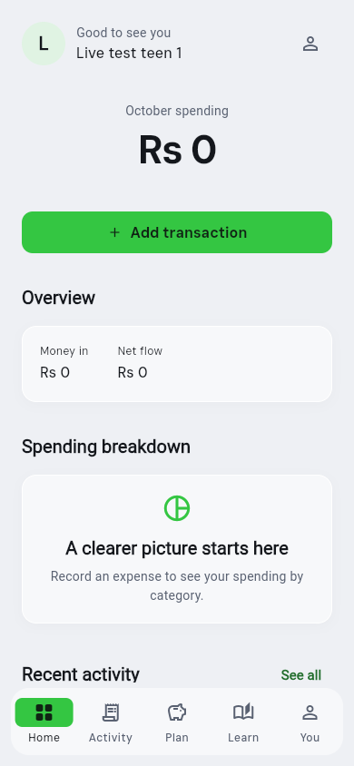 | 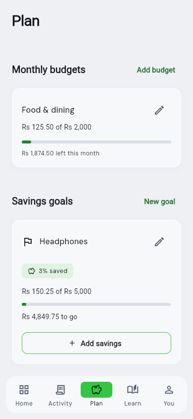 |

| Separate account | Password recovery |
|---|---|
|  | 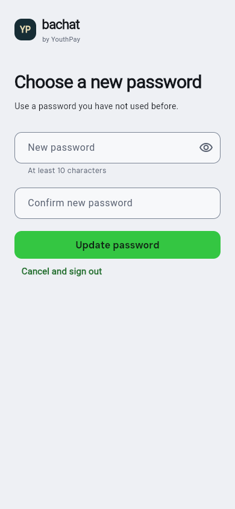 |

## Deployment boundaries

Tokens were prepared for the approved fixtures, so these checks establish Auth/session behavior rather than delivery to an inbox. A request to their reserved invalid email domain returned `email_address_invalid`; this does not establish real-recipient SMTP readiness. Real inbox confirmation and recovery remain unverified.

The hosted server honored localhost callbacks but rejected `com.getyouthpay.bachat://auth/callback` and fell back to the web site URL. Apply the prepared configuration using an authenticated Supabase CLI session; available MCP tools cannot change Auth settings. CLI is currently signed out. Native email links cannot be claimed complete until this is applied and tested on a device. See [backend setup](BACKEND.md).

The earlier Android CI failure occurred during artifact upload because GitHub's account storage quota was exhausted; compilation succeeded. Uploads are now opt-in for manually dispatched runs, while Android compilation remains mandatory for every PR.

## Earlier isolated browser checks

Before the approved live fixtures, isolated browser transport simulations covered sign-in, profile completion, empty records, CRUD, offline edits and sign-out. They also reported zero page errors. The live invalid-credential response and greyed-out parent onboarding were checked separately. Those earlier screenshots follow.

| Teen onboarding | Sign in | Live invalid credentials |
|---|---|---|
| 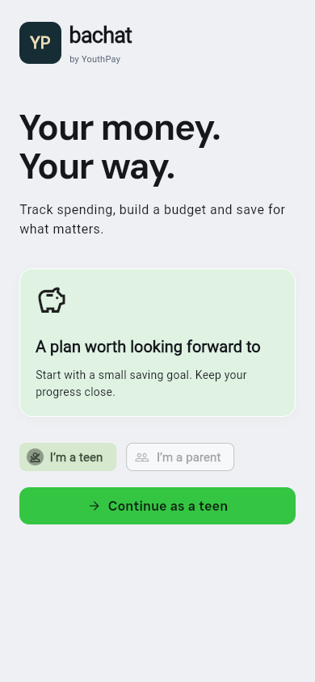 | 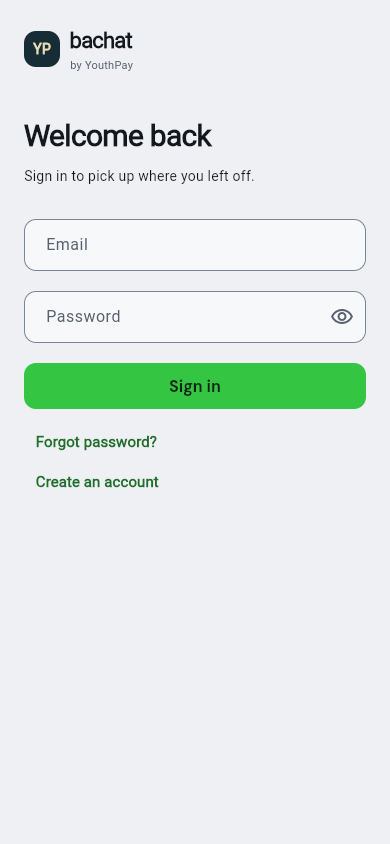 | 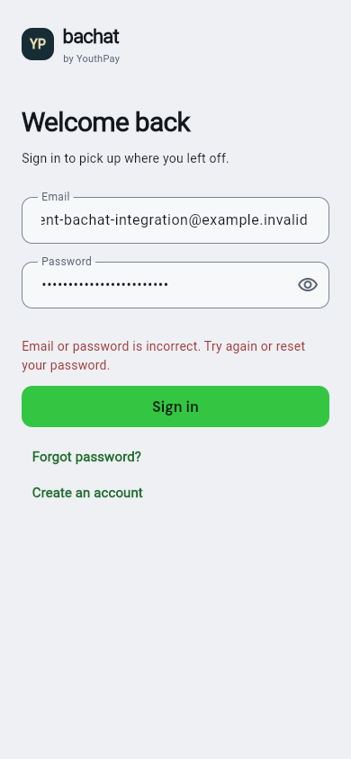 |

| Profile completion | Empty dashboard | Plan |
|---|---|---|
| 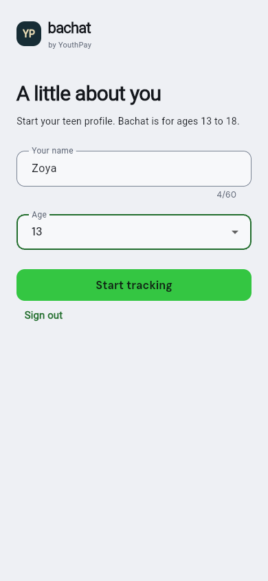 | 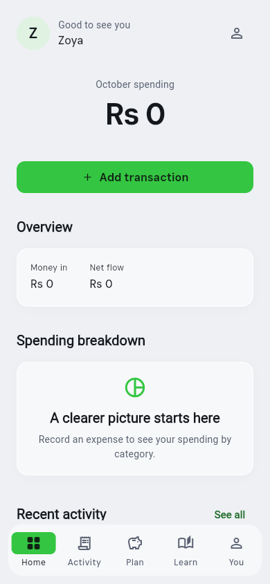 |  |

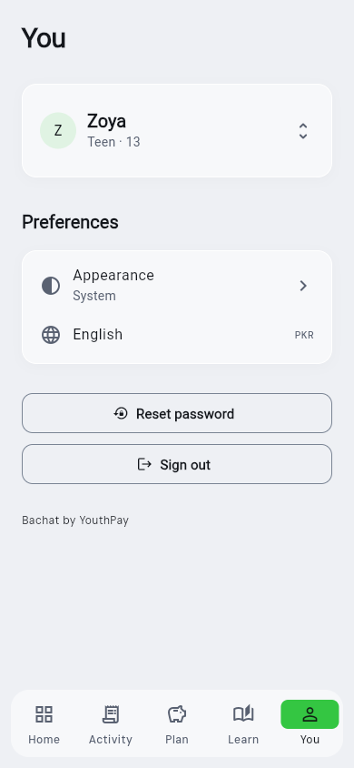

The previous local Next.js application was removed at the owner's request. Flutter and sibling brand assets remain. Earlier verification notes below are historical and include sample personas that are not exposed by the current app.

---

# Demo verification

36 domain, repository, controller and widget tests passed. Coverage includes persistent shared demo records, persona restoration, reset, mutual family approval, read-only parent enforcement, access removal, exact money parsing, validated transactions/budgets/goals, narrow/large-text layouts, profile/appearance sheets, retained searches, empty-filter recovery, carousel buttons, startup skeleton, calendar boundaries, date/category filters, sorting, exact savings increments, savings persistence and limits, and previous-month budget reuse without overwrites. Analyzer is clean.

Web release compilation and Windows Android arm64 debug APK compilation pass. Chrome at 390 × 844 verified teen and parent dashboards, Plan, Learn, persona switching, transaction save feedback, live total updates, search retention, goal creation/carousel navigation, appearance changes and parent restoration after reload, with zero page errors. Light and dark screenshots were visually inspected. Widgets cover 320px and 200% text scaling. This is targeted usability/accessibility verification, not certification of every HCI principle or an assistive-device audit.

Measured light-theme sRGB contrast: button text #102314 on #34C642 **7.31:1**; body #14171C on #EEF0F4 **15.74:1**; secondary #596171 on #EEF0F4 **5.46:1**; readable green #216D2C on #F7F8FA **6.01:1**. Selected navigation icons use dark primary text in both themes.

Demo records stay on this device. Authentication and cloud synchronization are deferred. No live login is claimed. iOS signing/device testing requires the Mac team; no physical Android test has been performed.

| Teen | Parent | Plan |
|---|---|---|
| 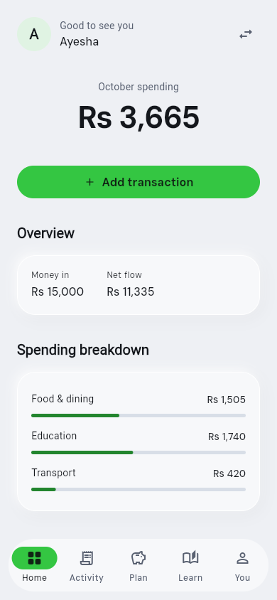 | 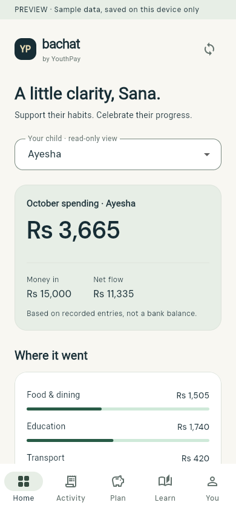 | 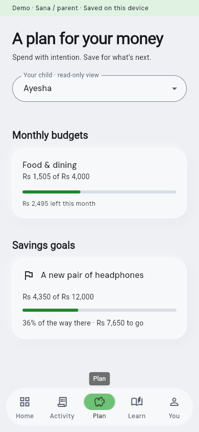 |

| Introduction | Learning | Dark theme |
|---|---|---|
| 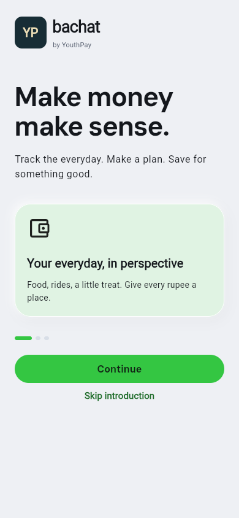 | 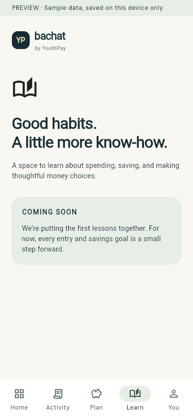 | 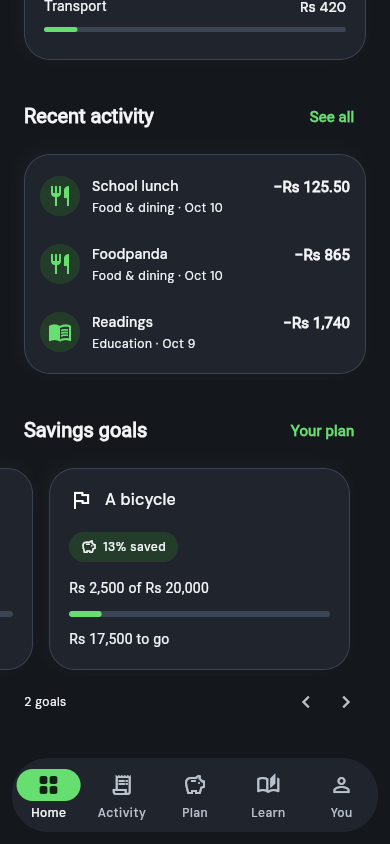 |

| Profile sheet | Settings | Transaction sheet |
|---|---|---|
| 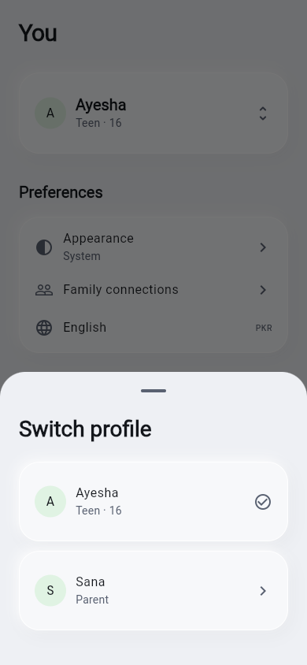 | 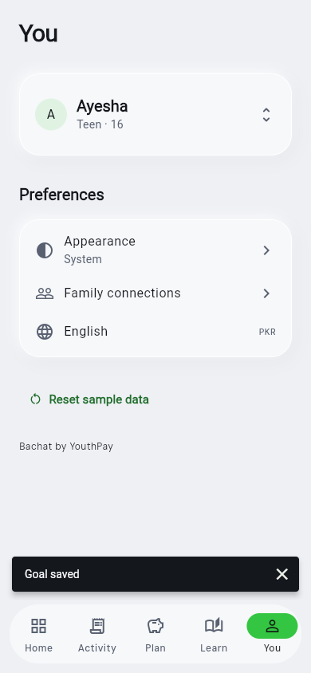 | 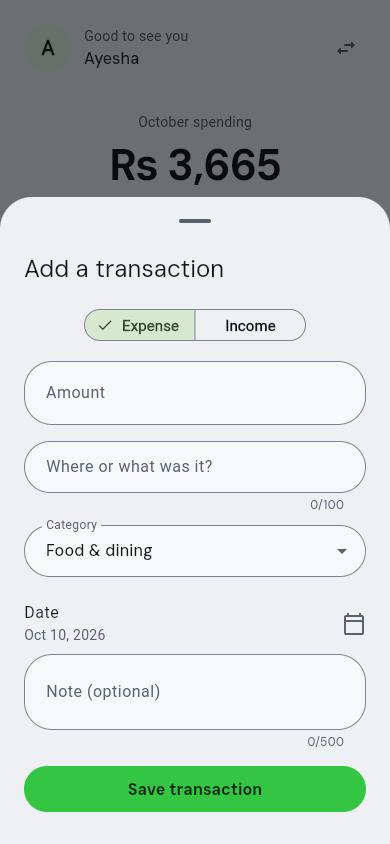 |

| Activity | Goal carousel |
|---|---|
| 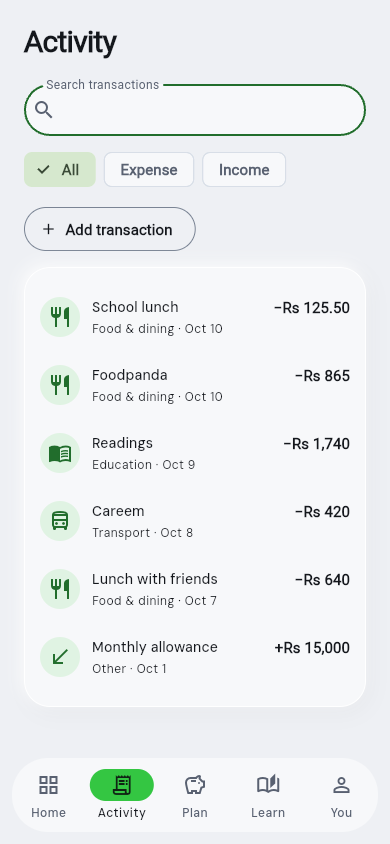 | 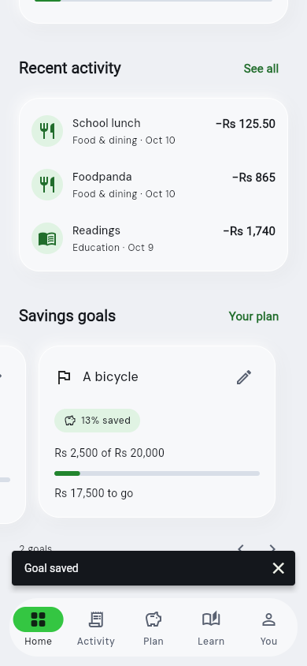 |

## Everyday money tools

Chrome at 390 x 844 verified last-month filtering, the applied-filter summary, clear-filter recovery and keyboard selection in the native period dropdown. Adding Rs 125.50 updated the sample goal from Rs 4,350 to Rs 4,475.50. The parent saw the same updated goal without edit controls, and the amount persisted after reload. This run reported zero page errors. Previous-month budget reuse is covered by controller/widget tests; the sample family has no previous-month budgets to exercise in this browser run.

| Filter sheet | Filter recovery | Savings sheet |
|---|---|---|
| 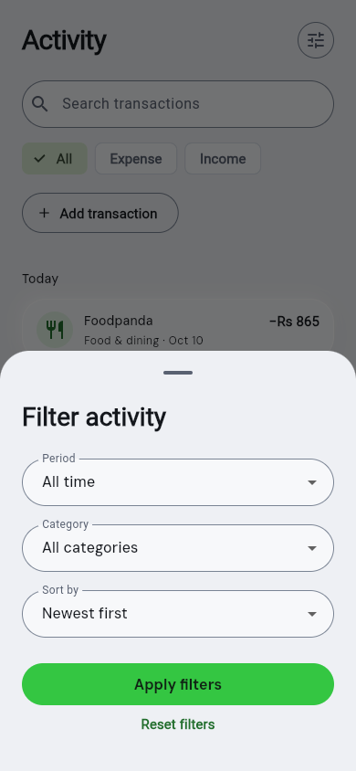 | 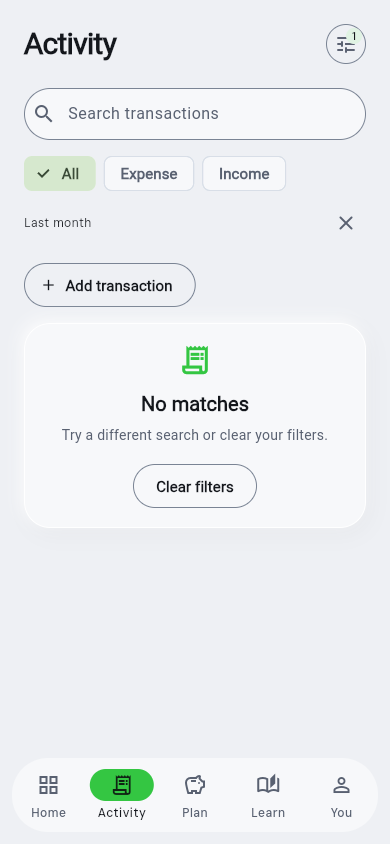 | 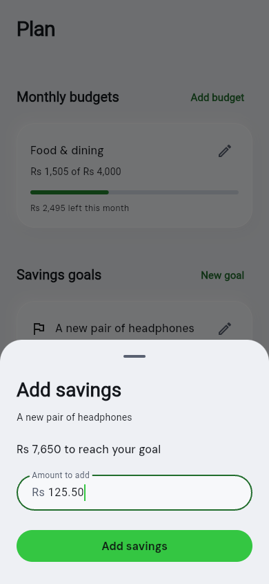 |

## Restrained shape refinement

The updated interface uses 12px control corners, 16px cards, 20px sheets/navigation and 8px badges/selection indicators. Card shadows use one subtle elevation layer. Chrome at 390 x 844 verified all tab transitions used in this pass, filter-sheet open/reset, savings-sheet open/dismiss, appearance switching and parent switching, with zero page errors. The eight screenshots below were visually inspected. Analyzer is clean and all 36 existing tests pass, including 320px / 200% text layouts. Earlier screenshots above document previous iterations.

| Home | Plan | Activity |
|---|---|---|
| 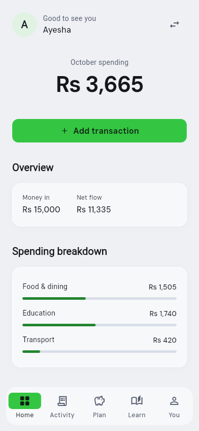 | 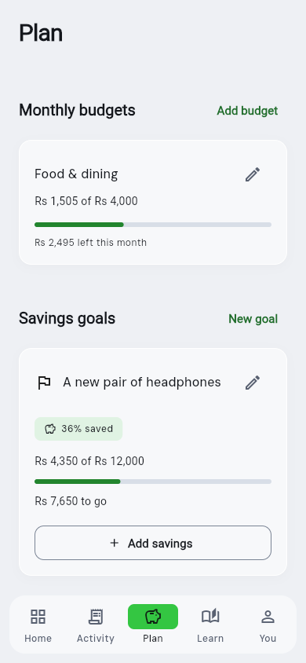 | 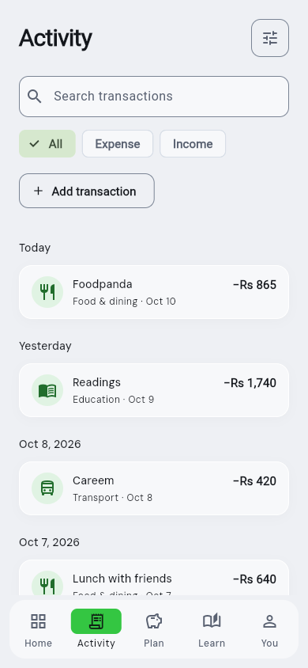 |

| Filters | Savings | Profile |
|---|---|---|
| 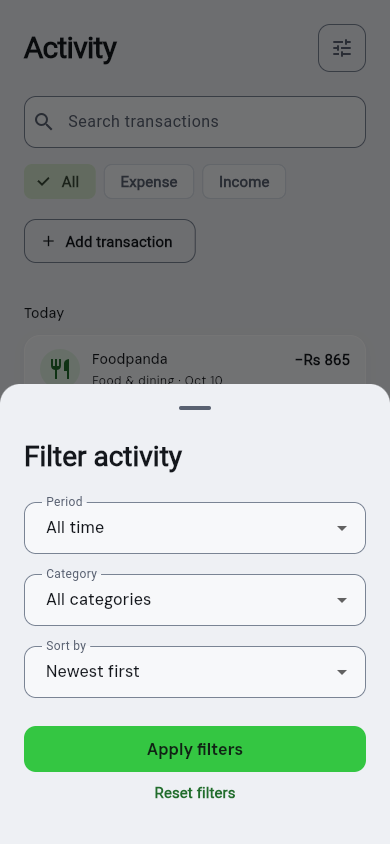 | 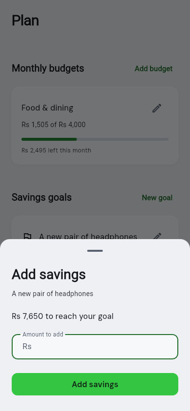 | 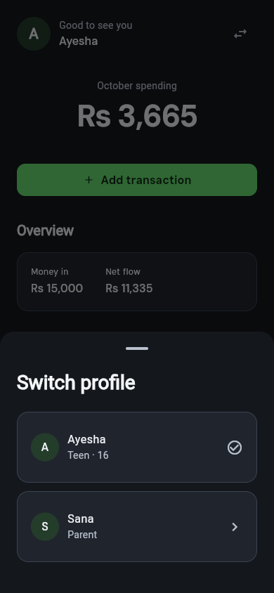 |

| Dark theme | Parent |
|---|---|
| 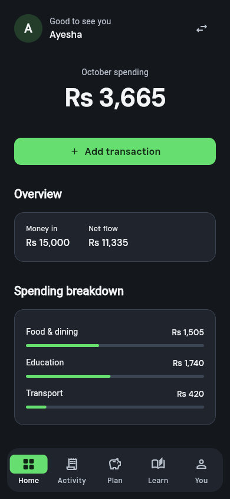 | 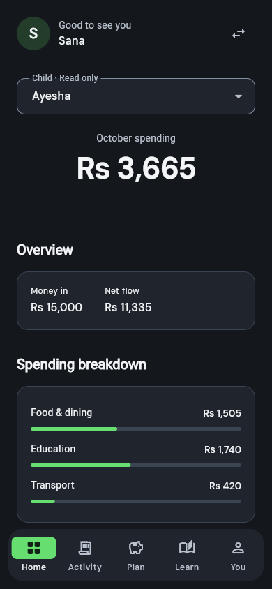 |

The final native-control pass also verified transaction-sheet opening and date-picker opening/cancellation in Chrome with zero page errors. The transaction selector and date dialog screenshots were inspected. Android arm64 debug and web release builds both pass for the final source.

| Transaction sheet | Date picker |
|---|---|
| 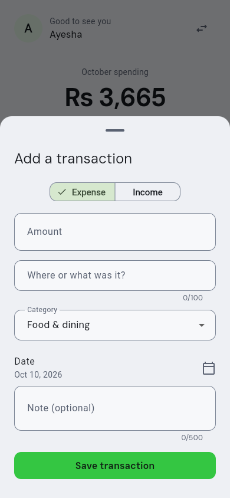 | 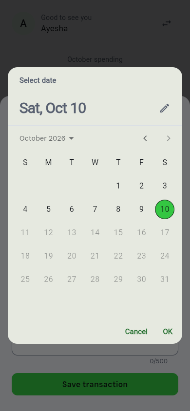 |
